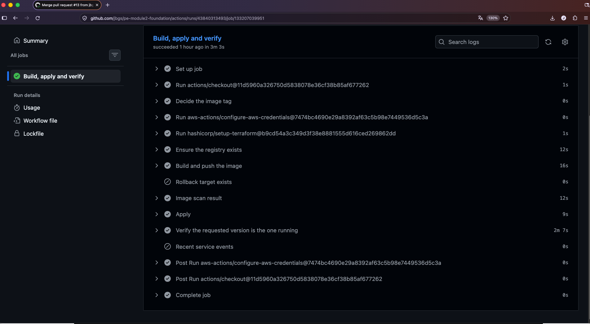

# One pipeline run from commit to release

The run below released the commit that reverted the deliberately faulty change (pull request #13, merged
2026-11-16 09:30:09 UTC). It is the `Deploy` workflow, run `43840313493`, which started on the merge to `main`.

## Steps (job `Build, apply and verify`, 3 min 3 s in total)

| Step | Result | Time (UTC) |
|---|---|---|
| Checkout, decide the image tag | success | 09:30:16 to 09:30:17 |
| Federated cloud login, set up Terraform | success | 09:30:17 to 09:30:18 |
| Ensure the registry exists | success | 09:30:18 to 09:30:30 |
| Build and push the image | success | 09:30:30 to 09:30:46 |
| Rollback target exists | skipped (not a rollback run) | n/a |
| Image scan result | success | 09:30:46 to 09:30:58 |
| Apply | success | 09:30:58 to 09:31:07 |
| Verify the requested version is the one running | success | 09:31:07 to 09:33:14 |

## From commit to running

| Time (UTC) | Event |
|---|---|
| 09:30:09 | merge of the pull request |
| 09:31:24 | the new task starts (task definition :11) |
| 09:32:15 | the previous task is stopped |
| 09:33:28 | ECS: `deployment completed`, the service has reached a steady state |

Merge to a healthy service on the new version took about 3 min 19 s. The step durations above are read from the
run's job data, not from memory.

## What this shows

- The path from commit to release is code (`.github/workflows/deploy.yaml`) and needs no manual step.
- It is observable: each step has a result, and the last one fails the run if the version running is not the
  one requested (see [`rollback.md`](rollback.md) for a run that failed on purpose).
- The scan step is where a later gate attaches. It is wired in and switched off (`SCAN_GATE=block` turns it on).

## Screenshot

The page of run `43840313493` in the repository's Actions tab, taken after the run: the job `Build, apply and
verify` succeeded in 3 min 3 s, with the steps above.

